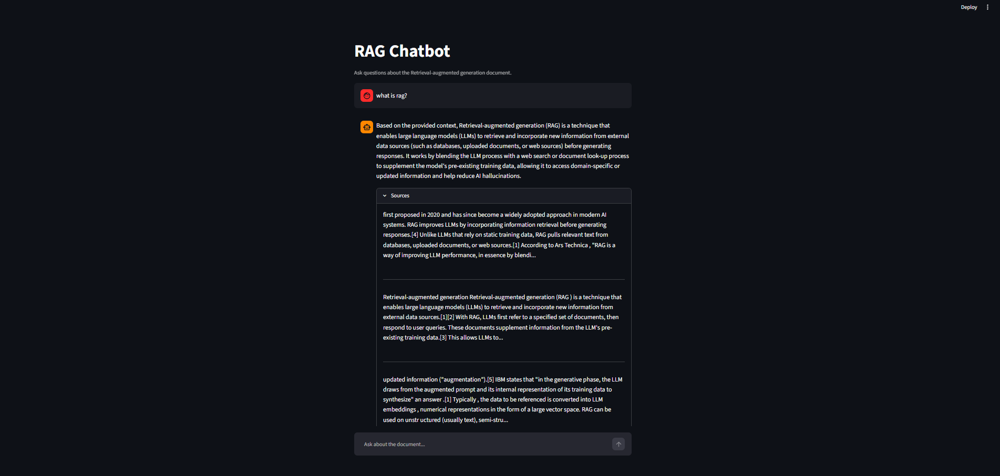
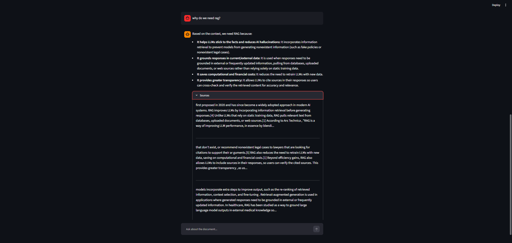

# Document Q&A Chatbot with RAG

A Retrieval-Augmented Generation (RAG) chatbot that answers questions about a PDF document. Instead of relying only on what the LLM already knows, it retrieves the most relevant chunks of the document and gives them to the LLM as context, so answers are grounded in the source.

Built with **LangChain**, **LangGraph**, **FAISS**, **Google Gemini** and **Streamlit**.

## Screenshots





## Architecture

```
PDF -> extract text -> remove references -> split into chunks
    -> Gemini embeddings -> FAISS index (saved to disk)

Question -> retrieve top-k chunks -> generate answer -> grade -> answer
                  ^                                        |
                  |------ not grounded: retry (more chunks)
```

LangGraph state graph:

1. **retrieve**: similarity search in FAISS (top 3 chunks, 5 on retry).
2. **generate**: Gemini answers using only the retrieved context.
3. **grade**: Gemini checks whether the answer is supported by the context (optional, can be switched off to save API quota).
4. **decide**: if the answer is not grounded, go back to retrieve with more chunks (maximum 2 attempts).

If the Gemini API is busy or the quota is finished, the app does not crash. It shows the most relevant passages from the document instead.

## Tech stack

| Layer | Tool |
|---|---|
| Language | Python 3 |
| LLM | Google Gemini (`gemini-3.8-flash`) |
| Embeddings | Google `gemini-embedding-001` |
| Vector store | FAISS (local) |
| Orchestration | LangChain + LangGraph |
| PDF reading | PyPDF2 |
| Interface | Streamlit |

## Project structure

```
RAG-Chatbot/
├── APP/
│   └── streamlit_app.py        # Chat UI (answers, sources, fallback)
├── src/
│   ├── __init__.py
│   ├── config.py               # Paths, model names, chunk sizes, API key
│   ├── ingest.py               # Load PDF, clean, chunk, embed, build FAISS index
│   ├── retriever.py            # Models, index loading, similarity search
│   ├── chains.py               # Prompt templates
│   └── graph.py                # LangGraph: retrieve -> generate -> grade -> retry
├── tests/
│   └── test_retriever.py       # Tests for cleaning, chunking and retrieval
├── data/
│   └── documents/              # Source PDF
├── vectorstore/
│   └── faiss_index/            # Saved index (generated, not committed)
├── screenshot/                 # Screenshots used in this README
├── rag_experiments.ipynb       # Experiments: chunking and retrieval quality
├── .env.example                # Template for the API key
├── requirements.txt
└── README.md
```

## Setup

1. **Clone the project and create a virtual environment**

   ```powershell
   python -m venv .venv
   .venv\Scripts\Activate.ps1
   pip install -r requirements.txt
   ```

2. **Add your API key**

   Get a key from https://aistudio.google.com/apikey, then copy `.env.example` to `.env` and edit it:

   ```
   GOOGLE_API_KEY=your_key_here
   ```

   Never commit the real `.env` file.

3. **Build the vector index (one time)**

   Run this from the project root:

   ```powershell
   python -m src.ingest
   ```

   It reads the PDF, removes the References section, splits the text into chunks, embeds them and saves the index to `vectorstore/faiss_index`.

4. **Run the app**

   ```powershell
   streamlit run APP\streamlit_app.py
   ```

## Tests

```powershell
python -m pytest tests -q
```

Three tests run without any API key. The retrieval test uses the saved index and is skipped if the index or key is missing.

## Retrieval experiments

Done in `rag_experiments.ipynb`:

- The PDF text contained a long References section (links, DOI numbers). It was removed, which reduced the text from 17,944 to 11,122 characters.
- `CharacterTextSplitter` (1000 characters) mixed unrelated headings in one chunk. `RecursiveCharacterTextSplitter` (800 characters, 150 overlap) was used instead, giving 17 clean chunks.
- `k = 3` gave the most relevant context. Higher values added chunks that were only loosely related.

## Example Q&A

**Q: What is RAG?**

A: Retrieval-augmented generation (RAG) is a technique that enables large language models (LLMs) to retrieve and incorporate new information from external data sources (such as databases, uploaded documents, or web sources) before generating responses. It blends the LLM process with a document look-up or web search process to help the model stick to facts and use domain-specific or updated information.

**Q: Why do we need RAG?**

A:
- It helps LLMs stick to the facts and reduces hallucinations.
- It lets models use domain-specific and updated information that was not in their training data.
- It saves the computational and financial cost of frequently retraining models.
- It allows models to cite sources, so users can verify the answers.

## Notes and limitations

- The free Gemini tier has a small daily request limit. `USE_GRADING = False` in `APP/streamlit_app.py` uses one LLM call per question instead of two.
- The chatbot answers only from the loaded document and says "I don't know" otherwise.
- Each question is answered independently (no conversation memory yet).

## Possible improvements

- Conversation memory for follow-up questions
- Upload your own PDFs from the UI
- Streaming answers